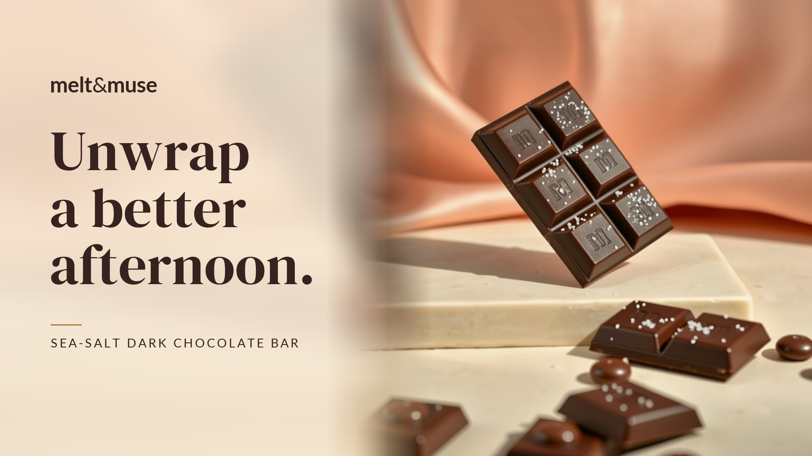

# Melt & Muse Campaign Studio

A local PHP app that turns a two-product brief into six campaign PNGs. Supply photographs or generate missing imagery with Cloudflare Workers AI. PHP handles the layout and lettering.



## Quick start

On **macOS**, paste this entire block into Terminal. The start script uses an existing PHP installation or installs PHP through [Homebrew](https://brew.sh/) when it is missing. If Homebrew is missing too, it runs the official installer first. Follow its prompts; it may request your Mac password. The first installation can take several minutes, especially on older Intel Macs.

```sh
git clone https://github.com/castomize/adobe-automation-for-social-campaigns.git &&
cd adobe-automation-for-social-campaigns &&
sh bin/start.sh
```

Already have this folder? Open Terminal in that folder and update it instead of cloning another copy:

```sh
git pull --ff-only && sh bin/start.sh
```

Alternatively, use **Code → Download ZIP**, extract it, and run `sh bin/start.sh` from the extracted folder. If macOS prompts to install Command Line Tools when running `git`, complete that installation and rerun the clone block, or use Download ZIP.

Open [localhost:8787](http://127.0.0.1:8787/) and select **Load example**. This renders all six PNGs using the included photographs, without credentials or API calls. Stop the server with Ctrl+C. If the port is occupied, run `STUDIO_PORT=8788 sh bin/start.sh` and open port 8788 instead.

The app requires PHP 8.2+ with cURL, fileinfo, GD, FreeType and ZIP. Startup checks these before serving the app and finds Homebrew PHP even when it is absent from PATH. An existing outdated or incomplete PHP installation reports what needs fixing. Fonts are bundled; no Composer, npm, database or build step is needed. Private storage is created automatically. Python 3 is only needed for tests.

On **Ubuntu 24.04 or Debian 12+**, including WSL, install prerequisites before using the clone block:

```sh
sudo apt-get update &&
sudo apt-get install -y git php-cli php-curl php-gd php-zip
```

For other Linux distributions, install equivalent PHP packages using your package manager. Automatic installation is macOS-only. The local workflow has been verified on macOS; Linux and WSL have not been independently verified.

## Reviewer walkthrough

1. **Load example** and inspect both products in square, vertical and landscape formats.
2. Change the campaign message to **“Make time for a better afternoon.”**, then select **Generate campaign**. The photographs are reused; no generation request is needed.
3. Open **Adjust crop**, change one format and select **Apply crop**. A separate version is saved with the same source photograph.
4. Select **Download campaign ZIP**. It contains six PNGs, organized by product and format.
5. Try **“A miracle afternoon.”** as the campaign message. Validation rejects the prohibited phrase before processing.

Request counts, source records and compliance results are recorded in `storage/runs/<run-id>/manifest.json`. The ZIP contains only images.

## Live image generation (optional setup)

To generate a missing photograph, configure your own Cloudflare Workers AI credentials. Create a private `.env` in the project root:

```sh
test -e .env || cp .env.example .env
chmod 600 .env
```

Set `CLOUDFLARE_ACCOUNT_ID` and `CLOUDFLARE_API_TOKEN` using Cloudflare's [Workers AI token instructions](https://developers.cloudflare.com/workers-ai/get-started/rest-api/). Keep `.env` out of version control. Environment variables take precedence.

Use the Workers Free plan. The app cannot check billing or remaining quota. After checking the plan in Cloudflare, this optional command requests one real image and saves it in `storage/smoke/`:

```sh
php bin/studio.php smoke --confirm-free-plan
```

The flag records your confirmation; it does not change the plan. There is no paid fallback. Loading the example or running the automated tests does not verify a live Cloudflare connection.

To exercise missing-asset generation in the app, open it in a fresh private browser window, upload one source photograph from `examples/sources/`, and leave the other product's upload empty. Select **Generate campaign**. A matching cached source is reused; otherwise the missing photograph is generated. Inspect the run's manifest for the actual request count. Use raw photographs as inputs, rather than finished ads with text already embedded.

## Try a campaign

The [sample brief](examples/sample-brief.json) describes a sea-salt dark chocolate bar and hazelnut truffles for working adults in the United States, with the message **“Unwrap a better afternoon.”**

1. **Load example**, or edit the brief and choose source images.
2. **Generate campaign** validates the submission, reuses available sources and generates missing ones.
3. Download each PNG or the **campaign ZIP**: product images only, organized by product and format. Briefs, manifests and sources stay in private storage. Incomplete campaigns export only available images.

Each product gets square 1080×1080, vertical 1080×1920 and landscape 1920×1080 PNGs. Headline changes reuse the sources.

**Saved campaigns** restores the brief, source images and outputs. **Keep** protects a run from deletion. **Delete** moves it to `storage/trash/`; to recover it, stop the server and move the whole folder back to `storage/runs/`.

**Adjust crop** controls position and scale for each format. **Apply crop** saves a new version using the existing photographs, without generation. **Reset** restores the default sliders; apply them to save. Original runs remain intact.

The included [source photographs](examples/sources/) reproduce the [approved exports](examples/outputs/). Both originated in Cloudflare; the bar was refined separately with FLUX.2 Klein editing. The sample brief preserves those source records. Loading the example is reuse, not new generation. Image editing is not part of the app.

## Design decisions

- `public/index.php` handles the form and endpoints; plain JavaScript builds the gallery and history.
- `Input.php` validates briefs/uploads and screens prohibited phrases.
- `Campaign.php` selects sources, requests missing imagery and saves runs. `CloudflareClient.php` uses FLUX.1 Schnell, four steps, at most two concurrent requests and a 90-second timeout. No automatic retries.
- `Renderer.php` crops photos and draws measured wordmark, headline and product text with GD. Copy that cannot fit is rejected.
- `Runs.php` handles browser-owned history, keep/delete actions and ZIP exports.

Cache keys include model, prompt and generation settings, excluding headline and crop settings. Reuse preserves original source records.

Runs live in `storage/runs/<run-id>/`: `brief.json`, `manifest.json`, `sources/` and `products/<product-id>/<ratio>.png`. Manifests record hashes, timings, API requests, errors and compliance checks. Partial failures preserve successful outputs.

## Checks and limits

```sh
python3 tests/run.py
```

Tests use a temporary project, setup command fixtures and a local provider fixture; they never install packages or call Cloudflare. They cover startup, validation, uploads, concurrency, failures, exact example reproduction, text fitting, history, crop revisions, ZIP integrity and private routes. `--keep-artifacts` retains test renders.

Uploads accept decoded JPEG, PNG or WebP up to 5 MiB, 256–4096 pixels per side and 8 million pixels. Secrets and runtime files stay outside the public directory. History uses a private HttpOnly cookie; writes require CSRF validation. Clearing cookies or changing browsers loses UI access, but leaves saved files intact. Older runs require their original session.

This app supports two products and English only. Crops are manual; reduced scale uses a blurred photographic extension. Brand checks inspect known wordmark/color pixels and text bounds; prohibited phrases come from `Input::PROHIBITED_PHRASES`. Neither performs OCR, product recognition or legal review. Generated details still need human review. The default square bar's fade overlaps its top; crop controls can move it. Uploads do not auto-rotate from EXIF. Cleanup is manual; the server is localhost-only.

Fonts: [Lato](assets/fonts/OFL.txt) and [DM Serif Display](assets/fonts/DMSerifDisplay-OFL.txt), under the SIL Open Font License.
